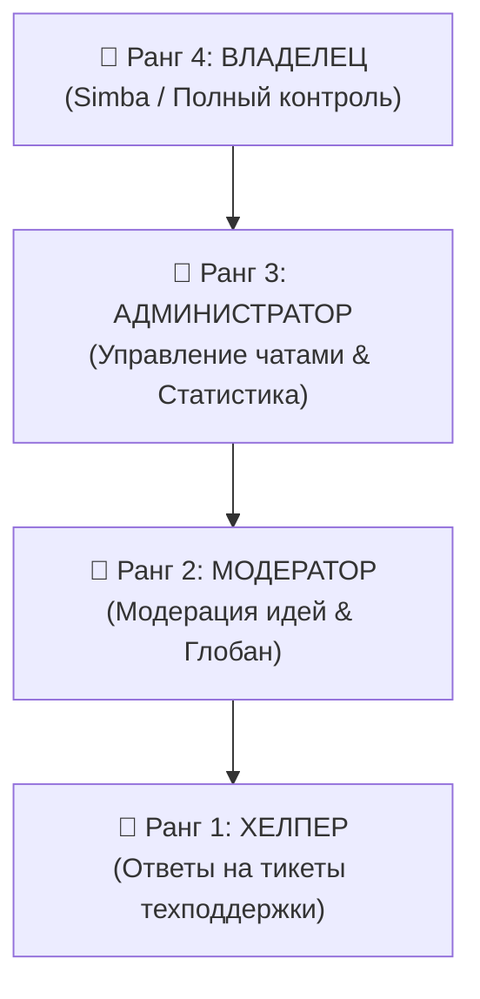

# 👑 Moxxi Bot 2.0: Супер-Админ Панель, Ранги Стаффа и Русские Аватарки

---

## 🎨 1. Аватарки на русском языке (1024×1024)

Все 5 неоновых аватарок на русском языке созданы в высоком разрешении **1024×1024 PNG** с четкими надписями, киберпанк-неоном и сохранены прямо в папку проекта `avatars/`:

| № | Файл | Название на аватарке | Назначение |
|---|---|---|---|
| 1 | `avatars/avatar_1_moxxi_bot_ru.png` | **MOXXI BOT • ГЛАВНЫЙ БОТ** | Основной аватар для профиля Telegram-бота |
| 2 | `avatars/avatar_2_ideas_group_ru.png` | **MOXXI ИДЕИ • ПРЕДЛОЖЕНИЯ** | Аватар группы для сбора идей и предложений |
| 3 | `avatars/avatar_3_chat_group_ru.png` | **MOXXI СООБЩЕСТВО • ЧАТ И ОБЩЕНИЕ** | Аватар официального чата для общения игроков |
| 4 | `avatars/avatar_4_reviews_group_ru.png` | **MOXXI ОТЗЫВЫ • ОТЗЫВЫ И РЕЙТИНГ** | Аватар группы/канала с отзывами и оценками |
| 5 | `avatars/avatar_5_support_group_ru.png` | **СЛУЖБА ПОДДЕРЖКИ • ТЕХПОДДЕРЖКА 24/7** | Аватар группы/чата техподдержки и тикетов |

> [!TIP]
> Также в папке `avatars/` сохранены оригинальные нейросетевые арты в стиле Octane Render (`chat_group_avatar_*.jpg`, `ideas_group_avatar_*.jpg`, `moxxi_bot_avatar_*.jpg`).

---

## 👑 2. Личная Супер-Админ Панель Владельца

Панель открывается **только в личных сообщениях с ботом** и защищена иерархией доступа.

- **Команды для открытия:** `панель`, `овнер`, `adminpanel`, `админка`, `/owner`

### 🔘 Интерактивные разделы меню:
1. **🆘 Тикеты поддержки** — список всех актуальных обращений игроков с кнопками быстрого ответа;
2. **💡 Модерация идей** — рассмотрение предложений сообщества (кнопки «✅ Принять» и «❌ Отклонить» прямо в панели);
3. **🚫 Черный список игроков** — глобальная блокировка нарушителей в боте (`глобан [uid] [причина]`);
4. **🛑 Чаты бота** — временное отключение или включение работы бота в отдельных беседах;
5. **👑 Состав стаффа** — просмотр всех назначенных сотрудников и их уровней доступа;
6. **🔗 Привязанные группы** — текущий статус привязки всех 4 системных чатов;
7. **⛔ Чёрный список групп (ЧС)** — список забаненных групп;
8. **📊 Глобальная статистика** — число игроков, монет, чатов и активных тикетов.

---

## 🔰 3. Иерархия Рангов Персонала (Staff)

В боте внедрена 4-уровневая сквозная система персонала:

| Ранг | Название | Доступные команды и функции |
|---|---|---|
| **1** | **🥉 Хелпер** | Просмотр открытых тикетов, отправка ответов пользователю: `+ответ [id_тикета] [текст]` |
| **2** | **🥈 Модератор** | Права Хелпера + модерация предложенных идей (`+принять [id]`, `+отклонить [id]`, `+реализовано [id]`) + глобальный бан нарушителей в боте (`глобан [uid] [причина]`, `разглобан [uid]`) |
| **3** | **🥇 Администратор** | Права Модератора + отключение и включение бота в группах (`выкл чат [chat_id]`, `вкл чат [chat_id]`) + просмотр глобальной статистики |
| **4** | **👑 Владелец** | **Абсолютный контроль**: назначение и снятие стаффа (`+стафф`, `-стафф`), привязка системных чатов (`+чат ...`), удаление нарушающих групп и занесение их в ЧС (`удалить группу [chat_id] [причина]`) |

### Управление стаффом (только Владелец):
- `+стафф [id/@username] [1-3] [должность]` — назначить сотрудника (бот отправит поздравление в ЛС);
- `-стафф [id/@username]` — отозвать полномочия;
- `стафф` / `персонал` — список всех действующих сотрудников.

---

## 🔗 4. Привязка Официальных Групп

Владелец может привязать чаты командой прямо в нужной группе или передав ID/ссылку:

- `+чат идей [id или ссылка]` — привязывает группу для предложений и голосований;
- `+чат отзывов [id или ссылка]` — привязывает группу для отзывов игроков и покупок;
- `+чат общения [id или ссылка]` — привязывает главный чат сообщества (команда `чат` ведет туда);
- `+чат поддержки [id или ссылка]` — привязывает чат для уведомлений о тикетах техподдержки;
- `привязанные чаты` — просмотр всех активных привязок.

> [!NOTE]
> При создании игроком отзыва или идеи бот автоматически отправляет красивую карточку в соответствующую привязанную группу!

---

## 🛡 5. Удаление Нарушающих Групп и Чёрный Список (ЧС)

Если группа нарушает правила (скам, нелегальные продажи, спам или интим/18+ характер):

1. **Команда удаления:**
   `удалить группу [chat_id] [причина]` (или `чс группы [chat_id] [причина]`)
2. **Что делает бот:**
   - Отправляет в нарушающую группу официальное уведомление с указанием причины блокировки;
   - Автоматически выходит из беседы (`leave_chat`);
   - Заносит `chat_id` в базу `blacklisted_chats`;
   - **Защита в Middleware:** если кто-то попытается снова добавить бота в эту группу, бот моментально отправит предупреждение и сразу выйдет!
3. **Разблокировка (при необходимости):**
   `снять чс группы [chat_id]`
